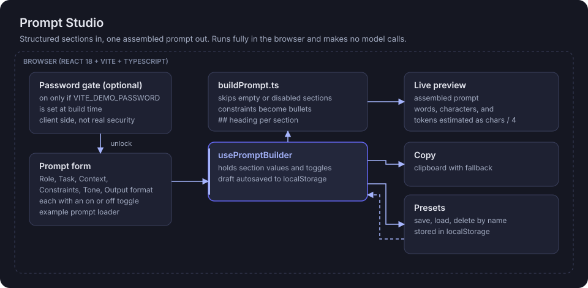

# Prompt Studio

**Build structured LLM prompts from labelled sections, preview the result live, and save the ones that work as presets.**

[](https://react.dev/)
[](https://www.typescriptlang.org/)
[](https://vite.dev/)
[](package.json)

**Live demo:** https://prompt-studio-lyart.vercel.app

> **Example:** set Role to "You are a senior product designer focused on accessibility", Task to "Review this onboarding flow and suggest three improvements", and add two Constraints on separate lines ("Under 200 words", "Avoid jargon"). Turn Tone off. The preview assembles a Markdown prompt with a `## Constraints` bullet list, skips Tone, and shows word, character and estimated token counts. Save it as the preset "UX review".

## Architecture



A static single-page app. It builds prompt text only; it does not call any model.

## How it works

1. **Section definitions.** `sections.ts` defines six sections (Role, Task, Context, Constraints, Tone, Output format), each with a hint, a placeholder and an on or off toggle, plus a one-click example prompt.
2. **Builder state.** `usePromptBuilder` holds the values and toggles and autosaves the draft to `localStorage`, so a refresh keeps your work.
3. **Assembly.** `buildPrompt.ts` is a pure function: it skips disabled or empty sections, writes a `## Heading` per section, and turns Constraints into a bulleted list (stripping any bullets you typed).
4. **Stats.** Words, characters and a rough token estimate (characters divided by 4). This is a UI hint, not a real tokenizer.
5. **Copy and presets.** One-click copy with a fallback. Named presets are saved, loaded and deleted through `usePresets`, validated on read.
6. **Optional gate.** If `VITE_DEMO_PASSWORD` is set at build time, `PasswordGate` asks for it once per tab session (`sessionStorage`).

## Run locally

Requires Node.js 18 or newer (20+ recommended).

```bash
npm install
cp .env.example .env.local   # optional, only for the password gate
npm run dev                  # http://localhost:5173
```

| Variable | Required | Purpose |
| --- | --- | --- |
| `VITE_DEMO_PASSWORD` | No | Turns on the client-side password gate. Leave empty to disable. |

## Evaluation

There is no automated test suite yet, and no prompt is ever run against a model, so there are no output quality results. `buildPrompt` and `estimateTokens` are pure functions and the natural first unit tests. Running presets against a model and scoring the replies would be the next step, not something this repo does today.

## Honest limitations

- A personal portfolio prototype with no real users.
- No model integration: it does not send, run or score prompts.
- The token count is an estimate (characters / 4), not a model tokenizer.
- The password gate is a casual deterrent only. `VITE_*` values are embedded in the public JavaScript bundle, so anyone can read it in dev tools. Never use a real password.
- Presets live in one browser's `localStorage`; no sharing, import or export.
- No automated tests.

## Stack

React 18, TypeScript 5, Vite 5, plain CSS with variables, browser `localStorage` and `sessionStorage`.

Part of the Lab at https://www.abhidattasrichandan.com
